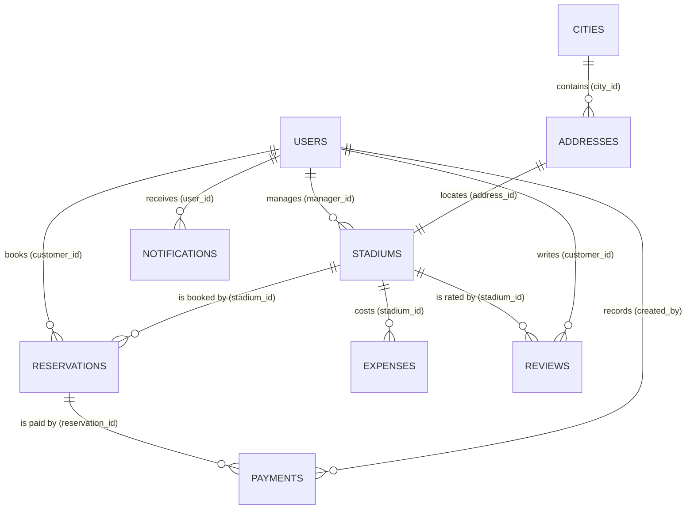

# Models

All persisted models extend [BaseEntity](Base/base-entity.md). Columns use `snake_case`; PHP properties use `camelCase`.

| Group | Model | Table | Doc |
| --- | --- | --- | --- |
| Base | BaseEntity | — (abstract) | [base-entity.md](Base/base-entity.md) |
| Users | User | `users` | [user.md](Users/user.md) |
| Regional | City | `cities` | [city.md](Regional/city.md) |
| Regional | Address | `addresses` | [address.md](Regional/address.md) |
| Stadiums | Stadium | `stadiums` | [stadium.md](Stadiums/stadium.md) |
| Reservations | Reservation | `reservations` | [reservation.md](Reservations/reservation.md) |
| Accounting | Payment | `payments` | [payment.md](Accounting/payment.md) |
| Accounting | Expense | `expenses` | [expense.md](Accounting/expense.md) |
| Settings | Setting | `settings` | [setting.md](Settings/setting.md) |
| Users | RolePermission | `role_permissions` | [role-permission.md](Users/role-permission.md) |
| Notifications | Notification | `notifications` | [notification.md](Notifications/notification.md) |
| Reviews | Review | `reviews` | [review.md](Reviews/review.md) |

Non-entity tables: `login_attempts` (identifier, ip_address, attempted_at) for sign-in throttling, and `schema_migrations` for applied migrations.

## Entity relationship diagram

## Relationship table

| Model | Inherits | Relation | Target | Foreign key | On delete |
| --- | --- | --- | --- | --- | --- |
| User | BaseEntity | one-to-many | Stadium (as manager) | `stadiums.manager_id` | set null |
| User | BaseEntity | one-to-many | Reservation (as customer) | `reservations.customer_id` | restrict |
| City | BaseEntity | one-to-many | Address | `addresses.city_id` | restrict |
| Address | BaseEntity | many-to-one | City | `city_id` | restrict |
| Address | BaseEntity | one-to-one | Stadium | `stadiums.address_id` (unique) | restrict |
| Stadium | BaseEntity | many-to-one | User (manager) | `manager_id` | set null |
| Stadium | BaseEntity | one-to-one | Address | `address_id` | restrict |
| Stadium | BaseEntity | one-to-many | Reservation | `reservations.stadium_id` | restrict |
| Stadium | BaseEntity | one-to-many | Expense | `expenses.stadium_id` | restrict |
| Reservation | BaseEntity | many-to-one | Stadium, User | `stadium_id`, `customer_id` | restrict |
| Reservation | BaseEntity | one-to-many | Payment | `payments.reservation_id` | restrict |
| Payment | BaseEntity | many-to-one | Reservation | `reservation_id` | restrict |
| Expense | BaseEntity | many-to-one | Stadium | `stadium_id` | restrict |
| Notification | BaseEntity | many-to-one | User | `user_id` | cascade |
| Review | BaseEntity | many-to-one | Stadium, User | `stadium_id`, `customer_id` (unique pair) | restrict |

Rows are never hard-deleted by the application: deletion sets `deleted_at` / `deleted_by` (soft delete), so `restrict` foreign keys protect history. Payments are never soft-deleted; a mistake is corrected with a refund entry.

## Indexes

| Table | Index | Why |
| --- | --- | --- |
| all | `PRIMARY(id)`, `UNIQUE(code)`, `deleted_at` | Identity, public code lookup, soft-delete filter |
| users | `UNIQUE(username)`, `UNIQUE(email)`, `UNIQUE(phone)`, `(role, is_active)` | Login, duplicates, role lists |
| cities | `(name, country_code)` | Duplicate check per country, enforced in `CityService` so a soft-deleted name can be reused |
| addresses | `(city_id)` | City filter on stadium search |
| stadiums | `(manager_id)`, `UNIQUE(address_id)`, `(sport_type, is_active)` | Manager scope, browse filters |
| reservations | `(stadium_id, status, start_at, end_at)`, `(customer_id, start_at)`, `(status, start_at)` | Overlap check, customer history, expiry sweep |
| payments | `(reservation_id)`, `(paid_at)` | Balance, report by date |
| expenses | `(stadium_id, expense_date)` | Report by stadium and period |
| settings | `UNIQUE(setting_key)` | One row per key |
| role_permissions | `UNIQUE(role, permission)` | One grant per pair |
| notifications | `(user_id, read_at, created_at)` | Unread badge and inbox |
| reviews | `UNIQUE(stadium_id, customer_id)`, `(stadium_id, deleted_at, created_at)` | One review per customer and stadium; review list |

## Case-insensitive uniqueness

`users.username`, `users.email`, `users.phone`, and every `code` are unique regardless of letter case or formatting:

1. `IdentityNormalizer` (regex-based) stores canonical values: lower-case username and email, phone without spaces/dashes/brackets, upper-case codes. Lookups normalize the same way.
2. The unique indexes use the `utf8mb4_unicode_ci` collation, so the database itself rejects `Customer` when `customer` exists.
