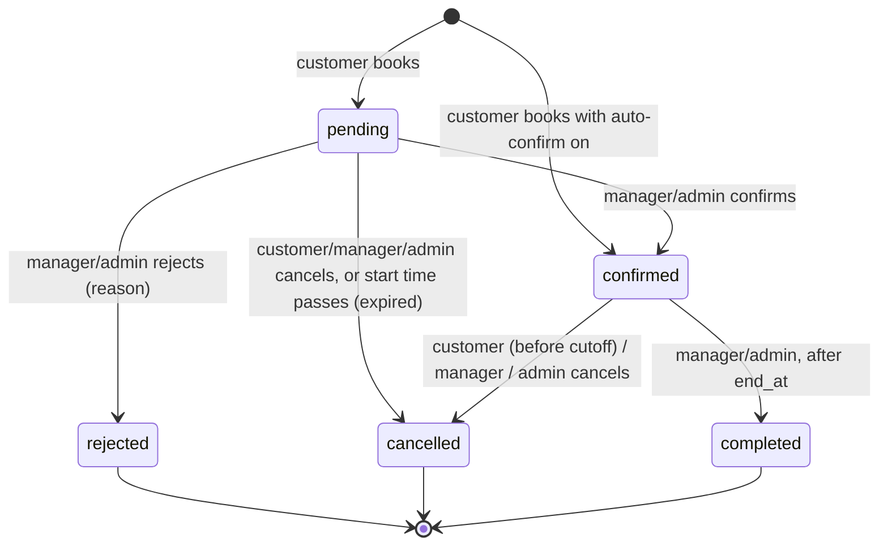

# Reservation lifecycle

## Transition table

Enforced server-side by `ReservationStatus::canTransitionTo()` and `ReservationService`.

| From | To | Who | Extra rules |
| --- | --- | --- | --- |
| — | `pending` (`confirmed` when `reservation.auto_confirm` = 1) | customer (`reservations.book`) | Hourly or daily range valid and free (see conflict resolution) |
| `pending` | `confirmed` | manager of the stadium, admin | Overlap re-checked under lock |
| `pending` | `rejected` | manager of the stadium, admin | Reason required |
| `pending` | `cancelled` | owner customer, manager, admin | |
| `confirmed` | `cancelled` | owner customer | At least `reservation.cancel_cutoff_hours` (default 2 h) before `start_at` |
| `confirmed` | `cancelled` | manager, admin | Any time before `end_at`; reason required |
| `confirmed` | `completed` | manager, admin | Only after `end_at` |
| `pending` / `confirmed` | same status, new time (reschedule) | manager, admin; owner customer while `pending` | May switch hourly ↔ daily; full conflict check excluding itself; unit price kept when the unit is unchanged; total and payment status recalculated |

Every other transition returns 409 `INVALID_TRANSITION`.

## Pending expiry

A `pending` reservation whose `start_at` has passed is set to `cancelled` with reason "Expired: not confirmed before start time". The sweep (`ReservationService::expireStalePending`) runs before reservation lists and dashboards load, so no cron job is needed on XAMPP.

## Money on cancellation

Cancelling never deletes payments. If `paid_amount > 0` the reservation shows "Refund due" until a manager records a refund (see [accounting](accounting.md)).
